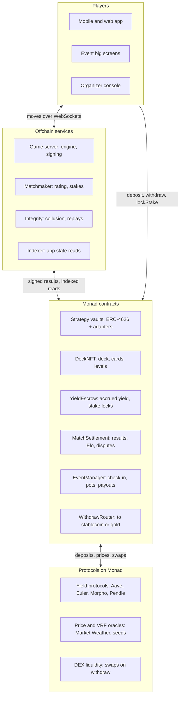
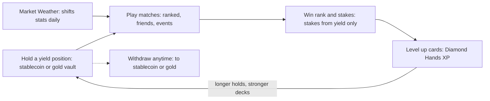

# YieldDeck — PRD & Technical Spec

Nov 4, 2026 · Wan

## Design evaluation

The core hook works: a deck that is also a live DeFi position gives every match real stakes and every card a personality driven by the market. Five rules in the first draft would break the game, so this spec replaces them. YieldDeck is a working name.

| Original rule | Why it breaks | Replacement in this spec |
| --- | --- | --- |
| +10 win / −15 loss | Negative-sum: a 50% win-rate player loses \~2.5 points per match forever. Ratings drift down and players stop queuing to protect rank. | Elo with start 500 and a K-factor that scales with the rating gap. Beating a stronger player pays more. |
| Loser gives up 0.1% yield | Undefined base (yield accrued, principal, or APY points). Paying value on match outcome is wagering, which is tightly regulated in Malaysia and many venues. | Stake comes only from a Yield Escrow of accrued yield, never principal. Capped per match. A zero-value Rank-only mode is always available. |
| High-yield deck = high-yield position | If yield or deposit size raises card power, whales win and new players churn. | Every deck has the same power budget. Risk tier changes variance and playstyle, not expected strength. Deposit size only raises the stake ceiling. |
| Win/lose moves value between wallets | Two wallets can lose on purpose to launder yield or farm rank. | Stake limits by rating gap, decay on repeat opponents, pair-frequency detection, minimum account age for staked play. |
| Battle royale at a physical venue | No one trusted to report results in a room of 64 players. | Server-authoritative engine, deterministic replay from a public seed, venue check-in, onchain settlement with a dispute window. |

### What we add to make it sticky

- **Market Weather**: live prices change card stats each match. When gold rallies, gold cards get a buff. Players open the app because the market moved.
- **Risk as playstyle**: Guardian decks are tanky and steady, Degen decks crit hard and swing. Both are viable.
- **Diamond Hands XP**: cards level up the longer the position stays deposited, which also protects TVL.
- **Seasons and a battle pass paid with yield**, daily quests, win streaks, tiered ranks with a soft reset.
- **Ghost battles**: fight a replay of a friend's deck when no one is online.
- **Clans and campus leaderboards**: a clan vault, clan wars at events, leaderboards per university and city.
- **Battle royale crash zone**: a "market crash" drains every deck each round so games end on time.
- **Spectator mode and emotes** at events. Cosmetic skins only; no paid loot boxes, which carry their own gambling risk.

## PRD

YieldDeck turns a yield-bearing RWA position on Monad into a collectible battle deck that players use in ranked online play and in battle royale at physical events. Principal stays the player's; only accrued yield is ever at stake.

### Problem

- Holding yield products is boring: users deposit, then forget the app. Retention and TVL churn suffer.
- Web3 games rarely give a reason to hold capital long term; most rewards are inflationary tokens.
- Community events (campus clubs, Superteam-style meetups) lack a shared onchain activity people can play in the room.

### Goals

1. Make holding an RWA position a daily habit through play.
2. Keep principal safe: game outcomes move only accrued yield and rating.
3. Run battle royale tournaments at physical venues with trustless results.
4. Let users exit to a stablecoin or tokenized gold in one flow.

### Non-goals (v1)

- No principal at risk in any mode.
- No paid loot boxes or random paid card packs.
- No in-house token at launch; rewards are paid in the vault's underlying assets.

### Target users

| Persona | Who | What they want |
| --- | --- | --- |
| DeFi holder | Already holds stablecoins or gold on Monad | Yield plus a reason to open the app daily |
| Competitive gamer | Plays card or auto-battler games | Skill-based ranked ladder with real but bounded stakes |
| Event player | Student or meetup attendee, new to crypto | Walk in, scan a QR, play in minutes without seed phrases |
| Organizer | Campus club, community lead, venue | Run a tournament with check-in, brackets and payouts handled |

### Feature scope

| Feature | Priority | Notes |
| --- | --- | --- |
| Deposit into a strategy vault and mint a deck | P0 | Stablecoin or gold in; Guardian, Balanced or Degen strategy |
| Ranked 1v1 (online) | P0 | Elo ladder, start 500, optional yield stake |
| Rank-only and Friendly modes | P0 | Zero value at stake; friend challenge links |
| Yield Escrow and match settlement | P0 | Stake locked at queue time, settled onchain |
| Withdraw to stablecoin or gold | P0 | Redeem shares, swap, slippage guard |
| Battle royale at venues | P1 | Check-in, pods, crash zone, prize pot |
| Market Weather | P1 | Oracle-driven stat modifiers per match |
| Diamond Hands XP and card levels | P1 | Levels from time deposited |
| Seasons, battle pass, quests, streaks | P1 | Pass purchasable with accrued yield |
| Ghost battles | P2 | Async play against replays |
| Clans and campus leaderboards | P2 | Clan vault, clan wars |
| Spectator mode and cosmetics | P2 | Event screens, skins, emotes |

### Success metrics

| Metric | Target at 90 days |
| --- | --- |
| D1 / D7 / D30 retention | 45% / 25% / 12% |
| Matches per daily active user | 6 or more |
| Deposits still in place after 30 days | 70% of TVL |
| Median session length | 12 minutes |
| Event check-in to first match | under 3 minutes |
| Settlement disputes | under 0.5% of staked matches |

Targets are starting assumptions to revisit after the first closed beta.

## Game design

Every deck gets the same power budget; the strategy behind it decides how that power behaves, and the market decides small daily swings. Skill and deck building decide most matches, not deposit size.

### Deck and card model

- One deck = one vault position. Deck NFT is bound to the vault shares while deposited.
- A deck holds 8 cards; 3 are active on the field, 5 are bench and swap-ins.
- Each card has an **asset class** (Stable, Gold, Treasury, Credit, BTC), stats (HP, ATK, DEF, SPD) and one ability.
- The deck's strategy decides which asset classes appear and its risk tier.
- Every card has a power budget of 100 points split across stats. Tiers move points between stats and variance, never add points.

### Risk tiers

| Tier | Example strategy | Playstyle | Crit chance / multiplier | Signature ability |
| --- | --- | --- | --- | --- |
| Guardian (low risk) | Stablecoin lending, T-bill tokens | High HP and DEF, steady damage | 5% / 1.3× | Peg Shield: blocks the first hit each round |
| Balanced (medium) | RWA credit plus gold | Even stats, flexible | 12% / 1.5× | Rebalance: swap a bench card in for free |
| Degen (high risk) | Leveraged loops, LP, basis trades | High ATK and SPD, low HP | 25% / 1.8× | Liquidation Strike: big hit, self-damage on miss |

Balance target: each tier wins 48–52% of ranked matches against each other tier. Patch stats each season if any matchup leaves that band.

### Match flow (ranked 1v1)

1. Both players lock their stake (if any) when they queue.
2. Match seed is fixed from verifiable randomness plus both players' commits.
3. Market Weather snapshot applies to all cards for this match.
4. Best of 5 rounds. Each round both players commit moves in secret, then reveal; the engine resolves by SPD.
5. A round lasts up to 20 seconds; a match runs about 3 minutes.
6. Result is signed and settled onchain; rating and stake move.

### Market Weather

- At match start the engine reads 24-hour price change per asset class from the oracle.
- Each 1% move gives ±2% ATK to that class, capped at ±10%.
- Stable cards get a small DEF buff on volatile days (BTC move over 5%).
- Weather shows on the lobby screen so players can swap decks to match the day.

### Ranking (Elo)

Rating starts at 500 and floors at 0. The expected score and update are:

```latex
E_A = \frac{1}{1 + 10^{(R_B - R_A)/400}} \qquad R_A' = R_A + K\,(S_A - E_A)
```

- S is 1 for a win, 0 for a loss. K is 32 for the first 30 matches, then 20.
- Two equal players move about ±10 to ±16, close to the original idea, but the ladder no longer drains.
- A loss streak of 3 or more halves the next loss (tilt protection); a win streak of 3 adds +3 per win.
- Seasons last 8 weeks. Soft reset: new rating = 500 + (old − 500) × 0.5.

| Tier | Rating |
| --- | --- |
| Bronze | 0–599 |
| Silver | 600–799 |
| Gold | 800–999 |
| Platinum | 1000–1199 |
| Diamond | 1200–1399 |
| Monad | 1400 and above |

### Yield stakes

Only accrued yield is ever at stake, and only in modes the player chooses.

- Each vault streams its yield into the owner's **Yield Escrow**. Principal never enters it.
- Ranked stake = 0.1% of the deck's deposit, paid from the escrow, capped at 5 USD per match at launch.
- Escrow too small for the stake → the match is played Rank-only.
- Settlement: winner gets 95% of the loser's stake; 5% goes to the season prize pool.
- Stakes allowed only within 300 rating points; beyond that the match is Rank-only.
- After the 3rd match against the same opponent in 24 hours, stakes drop to zero for that pair.
- Staked play needs an account at least 7 days old with 10 Rank-only matches.

### Game modes

| Mode | Where | Players | Stake | Rating |
| --- | --- | --- | --- | --- |
| Ranked | Online | 1v1 | Optional, from escrow | Yes |
| Rank-only | Online | 1v1 | None | Yes |
| Friendly | Online or in person | 1v1 via link or QR | Optional, both agree | No |
| Ghost | Online | 1 vs a replayed deck | None | No, quest progress only |
| Battle royale | Physical venue | 8–64 | Fixed entry from escrow into event pot | Event leaderboard plus a season bonus |

### Battle royale rules

- Players check in at the venue and are split into pods of 8.
- Each round pairs survivors within a pod; HP carries over between rounds.
- **Crash zone**: from round 3, every deck loses 10% max HP at round start, growing 5% each round.
- Pod winners meet in a final table. Top 3 share the pot 60 / 25 / 15 after a 5% organizer fee.
- Big screens show live brackets, spectator view and emotes.

### Progression and retention loops

| Loop | Cadence | Reward |
| --- | --- | --- |
| Daily quests (win 2, play a Guardian deck, use an ability 5 times) | Daily | Pass XP, cosmetic shards |
| Win streaks | Per session | Bonus rating, streak badge |
| Diamond Hands XP | Daily, passive | +1 card level per 7 days deposited, max level 10 |
| Battle pass | 8-week season | Free track; premium track bought with accrued yield |
| Clan wars | Weekly | Clan vault bonus, banner cosmetics |
| Campus and city leaderboards | Season | Event invitations, titles |

- Each card level adds +1% to stats, capped at +10%. Ranked matchmaking prefers players within 3 average levels.
- Withdrawing a deck keeps 50% of its XP if the player redeposits within 30 days.
- Cosmetics (skins, card backs, emotes) never change stats.

## Technical spec

Money and results live onchain on Monad; the match engine runs offchain for speed but is deterministic, so any match can be replayed and checked from its seed and move log. Monad's EVM compatibility, sub-second blocks (client updates reached [300ms block times](https://youmind.com/pt-PT/landing/x-viral-articles/monad-blockchain-economy-growth-analysis)) and existing RWA liquidity make per-match settlement practical.



Players sign deposits, withdrawals and stake locks straight to the contracts; everything else in a match goes through the game server, and only signed results reach settlement.

### Smart contracts (Solidity, Monad mainnet)

| Contract | Responsibility |
| --- | --- |
| `StrategyVault` (ERC-4626, one per strategy) | Holds deposits, routes to yield adapters, reports share price |
| `StrategyAdapter` (per protocol) | Deposit and withdraw into lending, RWA credit or gold strategies; isolates protocol risk |
| `DeckNFT` (ERC-721) | One token per deck; stores strategy id, card set hash, level data; non-transferable while shares are bound |
| `YieldEscrow` | Receives harvested yield per deck; locks and releases match stakes; principal can never be pulled here |
| `MatchSettlement` | Verifies signed results (EIP-712), moves stakes, emits rating updates, holds a 10-minute dispute window |
| `RatingRegistry` | Stores Elo per player per season; updated only by `MatchSettlement` |
| `EventManager` | Creates venue events, issues check-in keys, holds battle royale pots, pays top 3 |
| `SeasonPass` | Sells premium pass for escrowed yield; tracks pass tiers |
| `WithdrawRouter` | Redeems shares and swaps to the chosen exit asset with a slippage limit |

All contracts are upgradeable behind a timelock and a multisig, with a pause guardian on vaults and settlement.

### Offchain services

| Service | Stack (suggested) | Role |
| --- | --- | --- |
| Game server | TypeScript or Go, WebSockets | Authoritative match engine, commit-reveal turns, signs results |
| Matchmaker | Redis queues | Pairs by rating, level and stake rules |
| Indexer | Custom indexer or hosted subgraph | Reads vault, deck, match and event state for the app |
| Oracle reader | Pyth pull feeds | Prices for Market Weather and for vault valuation |
| Integrity service | Python or SQL jobs | Collusion detection, repeat-pair limits, dispute replays |
| Client | React Native and web, Phaser or PixiJS for battle | Deck builder, battles, event mode, wallet |

### Randomness and fairness

- Match seed = hash of a verifiable random number plus both players' committed salts. Pyth Entropy and other VRF providers are listed for Monad in the [Monad oracle docs](https://monad-docs-ipmtpgbzb-monad-xyz.vercel.app/tooling-and-infra/oracles).
- The engine is a pure function: `result = simulate(seed, decks, weather, moves)`. The same inputs always give the same result.
- Each turn both clients send a hash of their move, then reveal it. The server rejects reveals that do not match.
- The move log hash is stored with the result, so any dispute is settled by replaying the log.

### Settlement sequence

1. On queue, the client calls `YieldEscrow.lockStake(matchId, amount)` with a session key.
2. Match ends; the server signs `Result{matchId, winner, loser, seasonId, moveLogHash, seed}`.
3. The winner's client (or a relayer) submits it to `MatchSettlement.submit`.
4. After 10 minutes with no dispute, stakes move and `RatingRegistry` updates.
5. A dispute triggers a replay by the integrity service; a mismatched result is voided and stakes return.

The loser never has to sign, because the stake was locked when they queued.

### Wallets and gas

- Embedded wallets with email or social login for event players; external wallets for DeFi users.
- Session keys scoped to `lockStake` and game actions, valid 24 hours, capped per day.
- A paymaster sponsors gas for check-in and settlement so new players never need MON first.

### Data model

| Entity | Key fields |
| --- | --- |
| Player | address, displayName, accountCreatedAt, clanId, campus |
| Deck | deckId, owner, strategyId, shares, cardIds\[8\], level, xp, depositedAt |
| Card | cardId, assetClass, tier, hp, atk, def, spd, abilityId, skinId |
| Match | matchId, mode, players\[2\], stake, seed, weatherSnapshot, moveLogHash, winner, status |
| Rating | player, seasonId, rating, matches, streak |
| Event | eventId, venue, organizer, checkInKey, entryStake, pods, pot, status |
| Escrow | deckId, available, locked |

### Assets on Monad

- Monad reports over [$550M in stablecoins](https://youmind.com/vi-VN/landing/x-viral-articles/monad-blockchain-economy-growth-analysis) including USDC, USDT and AUSD, a good fit for deposit and stable exit.
- Tether Gold is [available on Monad](https://youmind.com/ja-JP/landing/x-viral-articles/monad-blockchain-economy-growth-analysis), a candidate for the gold exit and gold strategy.
- Yield candidates already live there include Aave V3, Euler, Morpho, Pendle and Maple's syrupUSDC. Confirm contract addresses, liquidity and redemption queues before building each adapter.

### Security

- Audits for vaults, escrow and settlement before mainnet; a bug bounty from launch.
- Per-vault deposit caps for the first season.
- Oracle sanity checks: reject prices that move more than a set band between reads; Market Weather caps at ±10% so a bad price cannot decide a match.
- Rate limits on the server, and signed builds for event kiosks.

## User flows

The core loop is deposit, play, earn, level up, and either play again or exit; every flow below feeds back into it.



Market Weather pulls players into a match each day, and every day a deck stays deposited makes it stronger; withdrawal is always one step away.

### 1. Onboarding and first deck

1. Open the app or scan an event QR code.
2. Sign in with email, social login or an external wallet.
3. Play a free tutorial match with a loaner deck (no deposit).
4. Pick a deposit asset: stablecoin or gold.
5. Pick a strategy: Guardian, Balanced or Degen. The screen shows expected yield range, risk notes and playstyle.
6. Approve and deposit. The app mints the Deck NFT and reveals 8 cards with an animation.
7. Optional: set a deck name, skin and clan.

### 2. Ranked match

1. Open Lobby; check today's Market Weather.
2. Pick a deck and toggle stake on or off. The app shows stake amount and escrow balance.
3. Tap Find Match. The stake locks via session key; the matchmaker pairs by rating.
4. Play 5 rounds of commit-and-reveal turns.
5. Result screen: rating change, stake won or lost, quest progress, streak.
6. Settlement finalizes after the dispute window; a toast confirms.
7. Rematch, next match or share result.

### 3. Battle royale at a venue

1. Organizer creates the event in the organizer console: venue, date, entry stake, max players.
2. Players arrive and scan the venue QR; the app checks the event key and location.
3. Entry stake moves from escrow to the event pot.
4. Players are seated into pods of 8; the big screen shows brackets.
5. Rounds run with HP carry-over; the crash zone starts in round 3.
6. Pod winners play the final table on stage with spectator view.
7. Top 3 are paid from the pot; all players get event badges and season points.

### 4. Friendly challenge

1. Tap Challenge and share a link or show a QR code.
2. Friend accepts; both see and agree to the stake (zero by default).
3. Play; no rating change.

### 5. Withdraw

1. Open the deck and tap Withdraw; choose full or partial.
2. Choose exit asset: stablecoin or gold. The app shows the quote, slippage and any redemption delay.
3. Confirm. The router redeems shares and swaps.
4. Locked stakes must settle first; the app shows the wait.
5. Funds arrive; the deck is retired (full withdraw) and keeps 50% XP for 30 days.

### 6. Season and battle pass

1. A season starts; ratings soft reset and new quests unlock.
2. Player buys the premium pass with escrowed yield or stays on the free track.
3. Daily quests and matches add pass XP; rewards are cosmetics and prize-pool entries.
4. Season ends; top ranks and clans receive the prize pool.

## Prototype requirements (Monad testnet)

The prototype MUST run on Monad testnet with real wallet-signed transactions for every deposit, match and withdrawal; nothing in the app may fake a transaction or a balance. This section is the build brief for Claude Code.

### Prototype decisions

These defaults hold for the prototype unless changed here; Claude Code should not re-decide them.

| Decision | Prototype choice |
| --- | --- |
| Ranking rule | Elo, start 500, K=32, floor 0 |
| Battle style | Auto-battle resolved onchain from a seed; no per-round player moves |
| Decks per wallet | Up to 5; deck type chosen at mint |
| Minimum deposit | 10 tUSD, or tGOLD worth 10 tUSD at the oracle gold price |
| Gold conversion | Live mainnet gold price, pushed by the same keeper into `RateOracle` |
| Card art | Generated SVG cards: tier-coloured frame, a simple asset-class icon, name and stats. No AI images or third-party characters |
| Challenge timeout | 1 hour; anyone can call `expire` to refund the locked stake |
| Draws | Stakes returned; Elo score 0.5 each |

### Network

| Parameter | Value |
| --- | --- |
| Network | Monad Testnet |
| Chain ID | 10143 |
| Gas token | MON |
| Public RPC | `https://testnet-rpc.monad.xyz` (25 rps), fallback `https://rpc.ankr.com/monad_testnet` |
| Explorers | `https://testnet.monadvision.com`, `https://testnet.monadscan.com` |
| Faucet (MON for gas) | `https://faucet.monad.xyz` |

Source: [Monad testnet docs](https://docs.monad.xyz/developer-essentials/testnets). Re-check before deploying; testnet values change.

### MUST

- [ ] Every user action is a real transaction signed by the user's wallet on chain ID 10143. No mock transactions, no local-only state for balances, decks, matches or ratings.
- [ ] The app reads all state (balances, decks, escrow, ratings, match results) from the chain or an indexer of the chain.
- [ ] Every transaction shows a pending state, then a link to its explorer page.
- [ ] Deploy test ERC-20s `tUSD` (6 decimals) and `tGOLD` (18 decimals) with a public `claim()` drip, rate-limited to once per 24 hours per address. Label them as testnet tokens in the UI.
- [ ] Yield accrues at live Monad mainnet rates read by a keeper into a testnet RateOracle (see Mainnet rate feed below), paid from a reserve the deployer funds. The rate is real; the payout is reserve-funded, and the UI must say so.
- [ ] Accrued yield flows into `YieldEscrow`; principal can never be moved by a match.
- [ ] Deck NFT (ERC-721) minted on deposit, one of the three decks below, burned or retired on full withdraw.
- [ ] Ranked 1v1: challenge, accept, both stakes locked onchain, battle resolved onchain from a seed, Elo (start 500, K=32) updated in the same contract.
- [ ] Stake = 0.1% of the deck's deposit, from escrow only; match falls back to Rank-only if escrow is short. Winner 95%, prize pool 5%.
- [ ] Battle resolution is deterministic from `(seed, deckA, deckB)`, so the client can replay and animate the exact onchain result from the emitted event.
- [ ] Randomness from Pyth Entropy if it is live on Monad testnet; otherwise commit-reveal of both players' salts plus a future block hash, marked prototype-only.
- [ ] Withdraw to `tUSD` or `tGOLD` through the router, using a fixed testnet conversion rate set by the deployer.
- [ ] Wrong-network detection with a one-click switch to chain 10143.
- [ ] Deploy scripts read the deployer key from an environment variable; no keys or secrets in the repo.
- [ ] Contracts verified on a testnet explorer after deploy.
- [ ] Unit tests for vault accounting, escrow locks, settlement, Elo and battle determinism.

### Mainnet rate feed

Testnet vaults MUST accrue at real Monad mainnet (chain ID 143) rates, pushed hourly by a keeper into a `RateOracle` contract on testnet.

| Tier | Mainnet source type | How the rate is read |
| --- | --- | --- |
| Guardian | Stablecoin lending market (e.g. Aave V3) | Reserve supply rate: `getReserveData(asset).currentLiquidityRate`, in ray (1e27) |
| Balanced | RWA credit vault (e.g. a yield-bearing stable like syrupUSDC) plus a gold leg if one exists | ERC-4626 share price: `convertToAssets(1e18)` sampled over a trailing 7 days, annualized; weighted 70/30 credit/gold |
| Degen | Higher-yield vault (e.g. a Morpho, Euler or sUSDe-style vault) | Same ERC-4626 share-price method |

- [ ] Keeper reads mainnet hourly and calls `RateOracle.setRates(guardianBps, balancedBps, degenBps, mainnetBlock)`; only the keeper address can write.
- [ ] Vaults accrue per second at the oracle's current rate, checkpointing on every deposit, withdraw and rate update.
- [ ] A single update may move a tier's rate by at most 200 bps; larger moves are applied in steps.
- [ ] A rate older than 24 hours is stale: vaults keep the last good rate and the app shows a stale warning.
- [ ] Rates are clamped to 0–50% APR to stop a bad read from draining the reserve.
- [ ] The app shows, per tier, the rate, "source: Monad mainnet", the source contract and the last update time.
- [ ] Before wiring a source, verify its mainnet address from the protocol's official docs and confirm it has live liquidity. If no gold lending or gold strategy exists on Monad mainnet, the Balanced tier uses its credit leg only and says so.
- [ ] Keeper RPC URLs and its private key come from environment variables; the keeper runs as a script or cron job in the repo.

### Suggested stack

Foundry for contracts and tests; Next.js with wagmi and viem for the app; contract addresses in one config file generated by the deploy script.

### Prototype contracts

The prototype uses this smaller set, not the production list in Technical spec. There is no game server.

| Contract | Responsibility |
| --- | --- |
| `TestToken` ×2 (`tUSD`, `tGOLD`) | Testnet ERC-20s with rate-limited `claim()`; owner can mint to fund the reserve |
| `RateOracle` | Keeper-written tier APRs and gold price, with staleness and clamp rules |
| `DeckVault` | Deposits per tier, per-second accrual from `RateOracle`, mints and retires decks |
| `DeckNFT` | ERC-721 deck with tier, 8-card lineup and onchain SVG `tokenURI` |
| `YieldEscrow` | Accrued yield per deck; locks and releases stakes |
| `Arena` | Challenges, seed, calls `BattleEngine`, settles stakes, updates Elo |
| `BattleEngine` (library) | Pure, deterministic battle simulation |
| `WithdrawRouter` | Redeems to `tUSD` or `tGOLD` at the oracle gold price |

One active stake per deck at a time. Ownership of all contracts sits with the deployer for the prototype.

### Out of scope for the prototype

Battle royale venue mode, Market Weather oracle feeds, battle pass, clans, embedded wallets and gas sponsorship. These follow once the 1v1 loop works on testnet.

### The three starter decks

All creatures are original. Every card's HP + ATK + DEF + SPD = 100. Public Pokémon TCG data may be used only as an aggregate reference for balance (HP bands, damage per turn); no Pokémon names, art or card text may appear anywhere in the prototype.

| Deck | Card | Asset class | HP | ATK | DEF | SPD | Ability |
| --- | --- | --- | --- | --- | --- | --- | --- |
| Guardian | Pegshell | Stable | 40 | 15 | 35 | 10 | Peg Shield: blocks the first hit each round |
| Guardian | Treasury Sentinel | Treasury | 38 | 18 | 32 | 12 | Coupon: heals 5 HP each round |
| Guardian | Bondback Tortoise | Treasury | 42 | 14 | 34 | 10 | Duration Lock: takes 10% less damage |
| Guardian | Ledger Owl | Stable | 30 | 22 | 26 | 22 | Audit: cancels one enemy crit per match |
| Guardian | Vault Golem | Gold | 36 | 24 | 30 | 10 | Safe Haven: +10% DEF when an ally faints |
| Guardian | Mint Sprite | Stable | 28 | 24 | 24 | 24 | Redeem: swaps with a bench card for free |
| Guardian | Coupon Crab | Credit | 34 | 22 | 30 | 14 | Hard Shell: reflects 10% of damage taken |
| Guardian | Reserve Bison | Treasury | 38 | 26 | 26 | 10 | Backstop: survives one lethal hit at 1 HP |
| Balanced | Aurum Lynx | Gold | 28 | 30 | 20 | 22 | Gold Rush: +10% ATK in round 1 |
| Balanced | Yield Heron | Credit | 30 | 28 | 22 | 20 | Accrue: +2 ATK each round it stays active |
| Balanced | Gilded Ram | Gold | 32 | 28 | 26 | 14 | Charge: first hit ignores 50% DEF |
| Balanced | Rebalance Fox | Credit | 26 | 28 | 18 | 28 | Rebalance: swaps a bench card in for free |
| Balanced | Collateral Bear | Credit | 34 | 26 | 28 | 12 | Overcollateral: +15% DEF below half HP |
| Balanced | Bullion Beetle | Gold | 30 | 24 | 30 | 16 | Store of Value: heals 3 HP each round |
| Balanced | Basis Kestrel | Treasury | 26 | 30 | 20 | 24 | Arbitrage: copies the enemy's SPD if higher |
| Balanced | Spread Serpent | Credit | 28 | 32 | 18 | 22 | Widen: −10% enemy DEF for 2 rounds |
| Degen | Leverage Raptor | BTC | 20 | 42 | 10 | 28 | 2x Long: double damage, takes double on a miss |
| Degen | Liquidation Wolf | BTC | 22 | 40 | 12 | 26 | Liquidation Strike: finishes enemies below 20% HP |
| Degen | Funding Wasp | BTC | 18 | 38 | 8 | 36 | Funding Rate: steals 3 HP each hit |
| Degen | Loop Kraken | Credit | 26 | 38 | 14 | 22 | Recursive Loop: hits twice at 60% damage |
| Degen | Perp Panther | BTC | 20 | 40 | 10 | 30 | Open Interest: +5% crit per round active |
| Degen | Ape Comet | BTC | 16 | 44 | 8 | 32 | Full Send: attacks first, ignores SPD order |
| Degen | Basis Mantis | Credit | 24 | 36 | 14 | 26 | Hedge: 20% chance to dodge |
| Degen | Halving Hydra | BTC | 24 | 38 | 12 | 26 | Halving: halves the enemy's next heal or shield |

Crit rules come from the risk tier table: Guardian 5% at 1.3×, Balanced 12% at 1.5×, Degen 25% at 1.8×.

### Battle engine

A match is a pure function `simulate(seed, deckA, deckB)` in the `BattleEngine` library; the TypeScript client port MUST give identical results. Where this section and the deck table's ability wording differ, this section wins. All math is integer with floor division; percentages are basis points (bps).

**Setup**

- Each deck has a lineup of 8 cards in order. Slots 1–3 are active; cards 4–8 are the bench, in order.
- Max HP = HP stat × 50. ATK, DEF and SPD are the card's stats.
- Random roll: `roll(n) = uint256(keccak256(abi.encode(seed, counter++))) % n`. Every roll consumes one counter value, in the order rolls happen below.
- Side A is the challenger, side B the acceptor.

**Each round (max 15 rounds)**

1. Start of round: apply start-of-round abilities. Roll `roll(2)` to pick which side wins SPD ties this round.
2. Action order: all living active cards, Full Send cards first, then by effective SPD descending; ties go to the side picked in step 1, then by lower slot.
3. Each card acts once if still alive and active. It targets the enemy in the same slot; if that slot is empty, the enemy active card with the lowest current HP, then lowest slot.
4. When a card faints, the next living bench card fills its slot at once but does not act this round.
5. End of round: heals, stat growth, swaps, then debuff timers count down by 1.
6. A side with no living cards loses. If both sides empty in the same action, it is a draw.

After round 15, the winner is the side with the higher total remaining HP as a share of total max HP across all 8 cards. Equal shares = draw.

**Damage, in this order**

```latex
\text{base} = \left\lfloor \frac{ATK_{eff} \times 1000}{50 + DEF_{eff}} \right\rfloor
```

1. Variance: base × (90 + `roll(21)`) / 100.
2. Crit: if `roll(10000)` < tier crit bps (Guardian 500, Balanced 1200, Degen 2500), × tier crit multiplier (130, 150 or 180) / 100.
3. Attacker abilities that change damage.
4. Defender abilities: dodge, then shields, then damage reduction.
5. Minimum 1 damage unless dodged or fully blocked.
6. After the hit: Backstop, then Liquidation Strike, then reflect, then lifesteal.

**Ability rules (authoritative)**

| Card | Ability | Exact rule |
| --- | --- | --- |
| Pegshell | Peg Shield | The first hit it takes each round deals 0 |
| Treasury Sentinel | Coupon | End of round: heals 5% of max HP |
| Bondback Tortoise | Duration Lock | Takes 90% of incoming damage |
| Ledger Owl | Audit | Once per match, while active, the first enemy crit against any ally becomes a normal hit |
| Vault Golem | Safe Haven | +10% DEF each time an ally faints, stacking to +30% |
| Mint Sprite | Redeem | Once per match, end of round below 30% HP: swaps with the first living bench card, keeping its HP |
| Coupon Crab | Hard Shell | Reflects 10% of damage taken to the attacker |
| Reserve Bison | Backstop | Once per match, a lethal hit leaves it at 1 HP |
| Aurum Lynx | Gold Rush | +10% ATK in round 1 |
| Yield Heron | Accrue | End of each round it is active: +2 ATK, up to +10 |
| Gilded Ram | Charge | Its first attack of the match ignores 50% of target DEF |
| Rebalance Fox | Rebalance | Once per match, end of round: the lowest-HP ally active card below 40% swaps with the first living bench card |
| Collateral Bear | Overcollateral | +15% DEF while below 50% HP |
| Bullion Beetle | Store of Value | End of round: heals 3% of max HP |
| Basis Kestrel | Arbitrage | Uses the highest enemy active SPD if higher than its own |
| Spread Serpent | Widen | Its hits set target DEF −10% for 2 rounds; refreshes, does not stack |
| Leverage Raptor | 2x Long | Each attack: `roll(100)` < 60 deals 2× damage; otherwise 0.5× and it takes 10% of its max HP |
| Liquidation Wolf | Liquidation Strike | After its hit, a target below 20% HP faints |
| Funding Wasp | Funding Rate | Heals 30% of damage it deals |
| Loop Kraken | Recursive Loop | Attacks twice at 60% damage, each with its own variance and crit rolls |
| Perp Panther | Open Interest | +500 bps crit at the end of each round it is active, up to +2500 |
| Ape Comet | Full Send | Always acts first in the round |
| Basis Mantis | Hedge | `roll(100)` < 20 dodges an incoming hit |
| Halving Hydra | Halving | Its hits halve the target's next heal |

**Output**

- `Arena` emits `MatchResolved(matchId, winner, seed, rounds, hpShareA, hpShareB)`.
- `BattleEngine` also exposes a view that returns the full action log, so the client can animate it and tests can compare logs with the TypeScript port.
- Gas: 15 rounds × at most 6 actions bounds the loop; test the worst case stays under the testnet block gas limit.

### Acceptance criteria

1. A new wallet can claim MON from the faucet, claim `tUSD`, deposit, and receive a deck NFT, all visible on the explorer.
2. Two wallets can complete a staked ranked match; both escrows, both ratings and the match event change onchain.
3. The client's replay of a match matches the onchain winner for 100 out of 100 test seeds.
4. A full withdraw to `tGOLD` returns principal plus the escrow balance, minus stakes lost.
5. A 10,000-match simulation of all deck pairings gives each deck a 48–52% win rate, or the stats are retuned before demo.

Plus: the testnet `RateOracle` rates match the mainnet sources within 0.1 percentage points after a keeper run, and the app shows each tier's source and update time.

### Handoff notes

- [ ] Deployer wallet funded with testnet MON from the faucet for deploys, keeper runs and reserve setup; the faucet may need several claims.
- [ ] Reserve funded by minting `tUSD` and `tGOLD` from the test token owner, so it does not depend on the faucet.
- [ ] Keeper runs from the repo as a script; locally during development, then on a scheduled job (e.g. GitHub Actions cron) for demos.
- [ ] `.env.example` lists every variable: deployer key, keeper key, testnet RPC, mainnet RPC, source contract addresses.
- [ ] Run the balance simulation before the first demo and retune stats if any pairing leaves 48–52%; record changes in the deck table.

## Risks, open questions and roadmap

The biggest risk is legal, not technical: staked matches and battle royale pots need a legal opinion in each launch market before real value moves.

### Risks

| Risk | Impact | Mitigation |
| --- | --- | --- |
| Staked play classed as gambling (Malaysia and venue countries) | Launch blocked, venue liability | Legal opinion first; Rank-only default; geofence staked modes; event pots as sponsor-funded prizes where required |
| Yield vaults classed as an investment product | Licensing duties | Use third-party protocols as the yield source; clear risk disclosures; legal review |
| RWA counterparty or redemption delay | Withdrawals slow or lossy | Diversify adapters; show redemption delay before deposit; per-vault caps |
| Smart contract exploit | Loss of funds | Audits, bug bounty, pause guardian, caps in season 1 |
| Oracle error | Unfair matches or bad vault pricing | Price bands, ±10% weather cap, fallback feed |
| Collusion and multi-accounting | Yield laundering, rank farming | Stake rules in Game design, integrity jobs, account age gates |
| Whale or meta dominance | Churn of new players | Equal power budget, level cap, tier balance patches each season |
| Low yield makes stakes feel tiny | Weak excitement | Pots aggregate across events and seasons; cosmetics and rank carry status |

### Open questions

- [ ] Confirm the exact meaning of the 0.1% stake: this spec uses 0.1% of deposit, paid from accrued yield only.
- [ ] Keep the original +10 / −15 rating rule, or adopt Elo as proposed?
- [ ] Which stablecoin and which gold token are the default exit assets?
- [ ] Which yield protocols back each strategy tier at launch?
- [ ] Do battle royale pots come from player entry, sponsors, or both?
- [ ] Is a game token planned later, and if so for what?

### Roadmap

| Phase | Timeline | Scope | Gate to move on |
| --- | --- | --- | --- |
| 0. Prototype | Weeks 1–4 | Engine, 1v1 Rank-only, testnet vaults | Matches feel fun in playtests with 30 players |
| 1. Closed beta | Weeks 5–10 | Mainnet vaults with caps, escrow, settlement, withdraw | Audit passed; legal opinion received |
| 2. Event pilot | Weeks 11–14 | Battle royale at 1–2 campus events, organizer console | Check-in under 3 minutes; zero disputes unresolved |
| 3. Season 1 | Weeks 15–22 | Market Weather, battle pass, quests, clans | D7 retention at or above 25% |
| 4. Scale | After season 1 | Ghost battles, spectator, more strategies and cities | Healthy tier win rates and TVL retention |

### Sources

- [The Monad Economy is Growing (Monad, July 2026)](https://youmind.com/vi-VN/landing/x-viral-articles/monad-blockchain-economy-growth-analysis)
- [Monad oracle and VRF providers (Monad docs)](https://monad-docs-ipmtpgbzb-monad-xyz.vercel.app/tooling-and-infra/oracles)
- [Monad 8 months after mainnet (KuCoin recap)](https://www.kucoin.com/news/insight/MON/6a7033146fa922000778149e)
